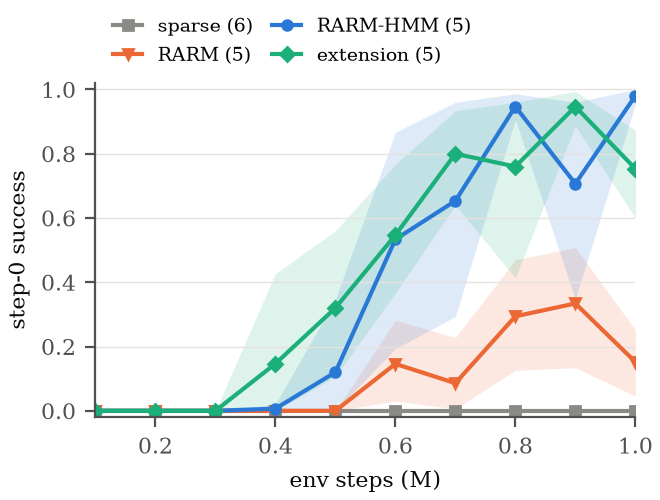
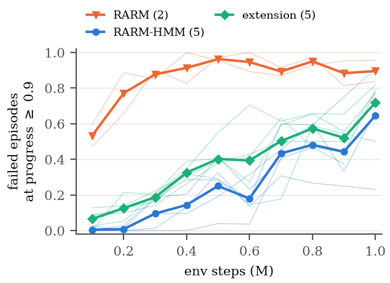

# RL results: AddSweetener, same-kitchen reference

Step-0 success after DrQ-v2 training with each reward: 30 trials per checkpoint from the demo's initial
state, every 100k env steps up to 1M. Commands: [EXPERIMENTS.md §2](EXPERIMENTS.md#2-rl-same-kitchen-main-experiment).
Per-run files: `outputs/rl/add_sweetener/<reward>/seed_<k>/eval/results.json`.

Status (2026-11-28): complete for this comparison. `rarm_hmm` seed 3 was rerun (the first attempt failed); `sparse` seed 5 is an extra sanity-check run.

## Mean across seeds

Mean step-0 success rate. "Last 3" is the mean over the 800k, 900k and 1M checkpoints, ± the standard
deviation across seeds of each seed's last-3 mean; "median" is the median of those per-seed means.

| Reward | Seeds | 100k–300k | 400k | 500k | 600k | 700k | 800k | 900k | 1M | **Last 3** | Median |
|---|---|---|---|---|---|---|---|---|---|---|---|
| `sparse` | 6 | 0.00 | 0.00 | 0.00 | 0.00 | 0.00 | 0.00 | 0.00 | 0.00 | **0.00 ± 0.00** | 0.00 |
| `rarm` | 5 | 0.00 | 0.00 | 0.00 | 0.15 | 0.09 | 0.29 | 0.33 | 0.15 | **0.26 ± 0.17** | 0.36 |
| `rarm_hmm` | 5 | 0.00 | 0.01 | 0.12 | 0.53 | 0.65 | 0.95 | 0.71 | 0.98 | **0.88 ± 0.14** | 0.91 |
| `rarm_ft_hmm_rel` | 5 | 0.00 | 0.15 | 0.32 | 0.55 | 0.80 | 0.76 | 0.95 | 0.75 | **0.82 ± 0.14** | 0.87 |

Mean over seeds with a 95% bootstrap interval (`pr-figures`). The `rarm` curve uses the rates from
issue #1 (`outputs/rl/add_sweetener/rarm/reported_rates.json`) until Aananth's eval files arrive.

## Successes per seed (out of 30)

| Reward | Seed | 100k | 200k | 300k | 400k | 500k | 600k | 700k | 800k | 900k | 1M | Last 3 |
|---|---|---|---|---|---|---|---|---|---|---|---|---|
| `sparse` | 0 | 0 | 0 | 0 | 0 | 0 | 0 | 0 | 0 | 0 | 0 | 0.00 |
| `sparse` | 1 | 0 | 0 | 0 | 0 | 0 | 0 | 0 | 0 | 0 | 0 | 0.00 |
| `sparse` | 2 | 0 | 0 | 0 | 0 | 0 | 0 | 0 | 0 | 0 | 0 | 0.00 |
| `sparse` | 3 | 0 | 0 | 0 | 0 | 0 | 0 | 0 | 0 | 0 | 0 | 0.00 |
| `sparse` | 4 | 0 | 0 | 0 | 0 | 0 | 0 | 0 | 0 | 0 | 0 | 0.00 |
| `sparse` | 5 | 0 | 0 | 0 | 0 | 0 | 0 | 0 | 0 | 0 | 0 | 0.00 |
| `rarm` | 0 | 0 | 0 | 0 | 0 | 0 | 1 | 0 | 5 | 0 | 0 | 0.06 |
| `rarm` | 1 | 0 | 0 | 0 | 0 | 0 | 1 | 1 | 1 | 6 | 1 | 0.09 |
| `rarm` | 2 | 0 | 0 | 0 | 0 | 0 | 1 | 1 | 17 | 14 | 6 | 0.41 |
| `rarm` | 3 | 0 | 0 | 0 | 0 | 0 | 8 | 11 | 14 | 12 | 6 | 0.36 |
| `rarm` | 4 | 0 | 0 | 0 | 0 | 0 | 11 | 0 | 7 | 18 | 10 | 0.39 |
| `rarm_hmm` | 0 | 0 | 0 | 0 | 0 | 17 | 29 | 26 | 30 | 29 | 30 | 0.99 |
| `rarm_hmm` | 1 | 0 | 0 | 0 | 0 | 1 | 30 | 30 | 27 | 30 | 30 | 0.97 |
| `rarm_hmm` | 2 | 0 | 0 | 0 | 0 | 0 | 0 | 1 | 30 | 20 | 30 | 0.89 |
| `rarm_hmm` | 3 | 0 | 0 | 0 | 0 | 0 | 8 | 29 | 27 | 1 | 29 | 0.63 |
| `rarm_hmm` | 4 | 0 | 0 | 0 | 1 | 0 | 13 | 12 | 28 | 26 | 28 | 0.91 |
| `rarm_ft_hmm_rel` | 0 | 0 | 0 | 0 | 0 | 2 | 8 | 15 | 2 | 25 | 26 | 0.59 |
| `rarm_ft_hmm_rel` | 1 | 0 | 0 | 0 | 1 | 17 | 29 | 30 | 30 | 29 | 14 | 0.81 |
| `rarm_ft_hmm_rel` | 2 | 0 | 0 | 0 | 0 | 4 | 14 | 22 | 26 | 30 | 28 | 0.93 |
| `rarm_ft_hmm_rel` | 3 | 0 | 0 | 0 | 21 | 21 | 14 | 26 | 28 | 28 | 22 | 0.87 |
| `rarm_ft_hmm_rel` | 4 | 0 | 0 | 0 | 0 | 4 | 17 | 27 | 28 | 30 | 23 | 0.90 |

## Provenance

All runs use the default `pr-train-rl` settings on TACC Lonestar6 with one A100 or H100 per run.

| Reward | Seeds | Run by | Notes |
|---|---|---|---|
| `sparse` | 0–4 | Haotian | Commit 7760ad7. No checkpoints shared. |
| `sparse` | 5 | Zhuorui | Commit 7760ad7. Sanity-check run. |
| `rarm` | 0–4 | Aananth | Counts come from the success rates he reported in issue #1; his result files are not in `outputs/` yet. Checkpoints were received and SHA-256 checked. |
| `rarm_hmm` | 0–1 | Zhuorui | Pre-reorganization layout (`rl_benchmark`). |
| `rarm_hmm` | 2, 4 | Haotian | Commit 7760ad7. No checkpoints shared. |
| `rarm_hmm` | 3 | Zhuorui | Commit 7760ad7 (rerun). |
| `rarm_ft_hmm_rel` | 0–4 | Zhuorui | Commit 7760ad7. |

Two earlier `rarm` runs are kept but not counted above, because seeds 0 and 1 were rerun with the
current pipeline:

| Run | 600k | 700k | 800k | 900k | 1M | Notes |
|---|---|---|---|---|---|---|
| `rarm/laptop_seed_0` | 1 | 7 | 2 | 0 | 1 | Earlier pipeline version (see its `PROVENANCE.md`) |
| `rarm/server_seed_1` | 0 | 1 | 15 | 6 | 15 | |

Both scored 0 at every checkpoint from 100k to 500k.

`rarm_hmm/incompleted_seed_0` is a laptop run that stopped at 500k (25/30).

## Sparse sanity check

The sparse runs score 0 from step 0, but they do succeed in training. 95% of training episodes start
from demo states, and the training success rate is 12–44% at 500k and 1M. Their shaping is 0, as
expected. So the sparse reward works; the policy only succeeds from states close to the goal.

An independent rerun (seed 5, run by Zhuorui) confirms this. It scores 0/30 at every checkpoint, with a
training success rate of 24% at 500k and 30% at 1M.

## Reward hacking during training

This figure shows the fraction of failed training episodes that end at ≥ 0.9 predicted progress. It
counts only episodes that start before the demo's midpoint, so the progress was earned during the
episode.

| Reward | Runs | 0–250k | 250k–750k | 750k–1M |
|---|---|---|---|---|
| `rarm` | 2 (`laptop_seed_0`, `server_seed_1`) | 0.63–0.75 | 0.93 | 0.85–0.95 |
| `rarm_hmm` | 5 | 0.00–0.06 | 0.12–0.31 | 0.21–0.79 |
| `rarm_ft_hmm_rel` | 5 | 0.06–0.16 | 0.26–0.53 | 0.52–0.71 |

Ranges are over runs. In the first 250k steps only 3 of about 2,200 such episodes succeed. Late in
training, failures are rare (about 40 per run) and many are near-misses.

## Note on `rarm_hmm` seed 3

Seed 3 scores 27/30 at 800k, 1/30 at 900k and 29/30 at 1M. Its training success rate around 900k
stays at 94–100%, so the drop is confined to that one evaluated checkpoint. It accounts for most of the
gap between the last-3 mean (0.88) and the median (0.91).
